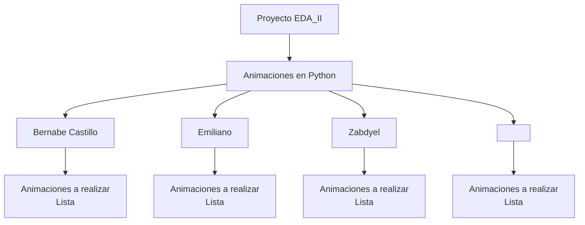

# Proyecto EDA_II
Este repositorio se usara para realizar las actividades relacionadas con el proyecto de EDA_II (*Estructura de datos 2*)
## Partes del proyecto
El proyecto esta conformado por la integracion de las aniamaciones relacionadas con el tema 2 de EDA_II en la cual se ve **Ordenamiento**
- ### Animaciones
- ### LeetCodes
- ### Reporte
## Ordenamiento
### Tipos de algoritmos de ordenamiento
####  Por comparación simples
* Insertion Sort
* Bubble Sort
* Selection Sort
#### Por comparación eficiente
* Merge Sort
* Quick Sort
* Heap Sort
#### Ordenamiento lineal
* Countig Sort
* Radix Sort

